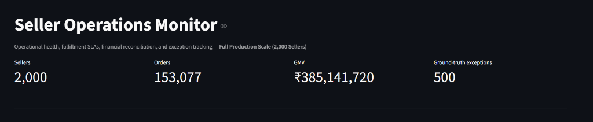
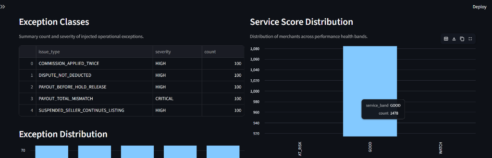
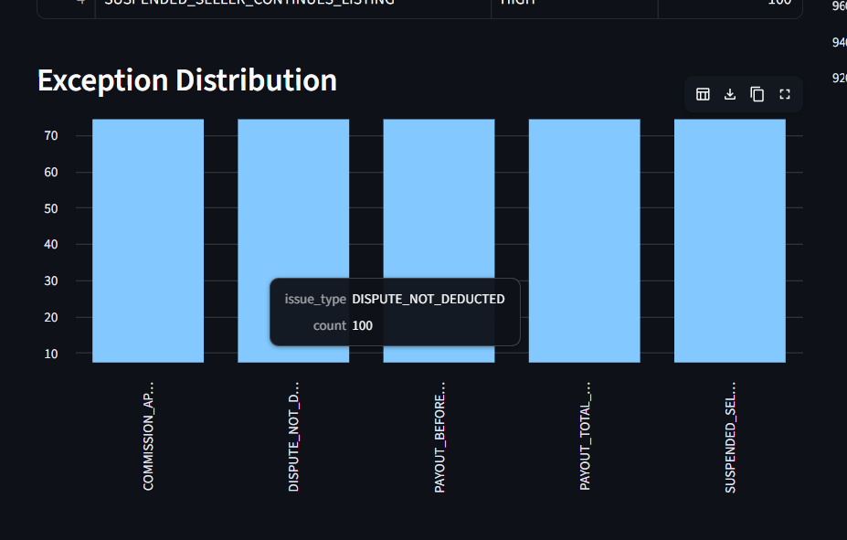

# Seller Operations Monitor

A reproducible marketplace operations monitoring platform that tracks seller service levels, order fulfillment SLAs, customer disputes, commission schedules, and payout reconciliation with injected business exceptions.

---

## Visual Dashboard Overview (Full Production Scale)

The platform includes an interactive Streamlit operations monitoring dashboard providing complete visibility into operational health, merchant service tiers, financial reconciliation, and injected anomaly distributions.

### 1. Operations Overview & Top KPIs (Full 2,000 Sellers Scale)
Displays macro-level operational metrics across the full production scale: **2,000 sellers**, **153,077 order lines**, **₹385,141,720 GMV**, and **500 ground-truth exceptions**.



---

### 2. Exception Classes & Service Score Distribution
Displays the 5 injected anomaly classes (exactly 100 cases each) with operational severity alongside the live merchant distribution across performance health bands.



---

### 3. Balanced Exception Distribution
Verification of the balanced 500 ground-truth anomalies across all 5 required business exception scenarios (100 cases per category).



---

## Core Capabilities

- **Master & Transactional Data Generation**: Deterministic, relational synthesis of sellers, catalog listings, multi-item orders, order lines, fulfillments, customer reviews, disputes, commission schedules, and payouts.
- **Multi-Seller Fulfillment Splitting**: Multi-line orders are split cleanly per seller with independent logistics tracking (carrier, tracking numbers, promised vs. actual ship/delivery dates, and delivery SLA tiers).
- **Seller Service Scoring**: Weighted operational score incorporating on-time shipping (40%), delivery success (25%), dispute-free rate (20%), and customer rating (15%).
- **Financial Settlement Engine**: Automated payout calculation factoring in product categories, seller commission tiers, return statuses, rolling risk reserves, and resolution of chargebacks.
- **Traceable Event History**: Seller status transitions (`PENDING`, `ACTIVE`, `SUSPENDED`, `REACTIVATED`) are recorded as immutable event rows in `seller_status_event` to prevent history loss.
- **Ground Truth Isolation**: Five distinct operational anomalies are injected into the dataset and recorded in a separate ground truth file (`ground_truth/ground_truth.csv`) to prevent label leakage into operational features.
- **Automated Validation & Checksums**: Automated tests verify primary/foreign key integrity, price and quantity bounds, arithmetic reconciliation, and reproducibility checksums (SHA-256).

---

## System Architecture

```text
Synthetic Master Data (Sellers, Listings, Customers)
         │
         ▼
Transaction Engine (Orders, Order Lines, Fulfillments, Disputes, Reviews)
         │
         ▼
Settlement Engine (Commission Rules, Risk Reserves, Payout Lines)
         │
         ▼
Deliberate Anomaly Injector (5 Injected Exception Scenarios)
         │
 ┌───────┴────────────────────────┬────────────────────────┐
 ▼                                ▼                        ▼
Exported Relational CSVs     Ground Truth Labels      Validation & Metrics Reports
(data/exports/)              (ground_truth/)          (reports/)
                                                           │
                                                           ▼
                                                Interactive Streamlit Dashboard
```

---

## Quick Start

### 1. Environment Setup

Create and activate a clean Python virtual environment:

```bash
# Windows:
python -m venv venv
venv\Scripts\activate

# Linux / macOS:
python3 -m venv venv
source venv/bin/activate
```

Install the dependencies:

```bash
pip install -r requirements.txt
```

### 2. Generate Data & Run Pipeline

**Fast Starter Scale** (20 sellers, 100 listings, 500 orders, 50 disputes):
```bash
python scripts/run_pipeline.py --config configs/starter.yaml
```

**Full Production Scale** (2,000 sellers, 20,000 listings, 100,000 orders, 10,000 disputes):
```bash
python scripts/run_pipeline.py --config configs/full.yaml
```

Outputs are automatically generated under `data/exports/`, `ground_truth/`, and `reports/`.

### 3. Run Automated Tests

Execute the automated test suite with Pytest:

```bash
python -m pytest -q
```

### 4. Launch the Streamlit Dashboard

Start the local monitoring dashboard:

```bash
streamlit run dashboard/app.py
```

Open your browser at `http://localhost:8501` to explore the interactive visual analytics.

---

## Business Logic & Formulas

### 1. Seller Service Score Formula

$$\text{Service Score} = \left( 0.40 \times \text{On-Time Rate} + 0.25 \times \text{Delivery Success Rate} + 0.20 \times \text{Dispute-Free Rate} + 0.15 \times \frac{\text{Average Rating}}{5} \right) \times 100$$

#### Performance Bands:
- **$\ge 90$**: `EXCELLENT`
- **$80 - 89$**: `GOOD`
- **$70 - 79$**: `WATCH`
- **$< 70$**: `AT_RISK`

---

### 2. Net Payout Settlement Formula

$$\text{Net Payout} = \text{Gross Amount} - \text{Commission} - \text{Dispute Deductions} - \text{Reserve Amount}$$

Where:
- **Commission**: $\text{Gross Amount} \times \text{Category Tier Rate}$
- **Reserve Amount**: $(\text{Gross Amount} - \text{Commission} - \text{Dispute Deductions}) \times \text{Seller Reserve Rate}$
  - Established sellers: 5%
  - New sellers (< 90 days): 15%
  - High-risk sellers: 25%
- **Eligibility criteria**: Order line must be delivered, past the 7-day hold window, non-returned, seller active, and free of open disputes.

---

## Injected Anomaly Classes

The platform deliberately injects 5 real-world exception classes to test monitoring controls:

| # | Anomaly Class | Target Entity | Injected Behavior | Expected Operational Action |
|---|---|---|---|---|
| 1 | `PAYOUT_BEFORE_HOLD_RELEASE` | Payout | Payout date shifted before delivery hold expiration | `BLOCK` disbursement |
| 2 | `COMMISSION_APPLIED_TWICE` | Payout Line | Duplicate fee line appended to settlement batch | `REVIEW` calculation |
| 3 | `SUSPENDED_SELLER_CONTINUES_LISTING` | Listing | Seller suspended while catalog items remain active | `BLOCK` listing visibility |
| 4 | `DISPUTE_NOT_DEDUCTED` | Payout Line | Resolved chargeback deduction zeroed out on payout | `HOLD` payout for adjustment |
| 5 | `PAYOUT_TOTAL_MISMATCH` | Payout | Header `total_amount` altered by +₹100 over sum of lines | `BLOCK` disbursement |

---

## Reproducibility

Determinism is guaranteed through a fixed random seed (`20261022`). Running the pipeline with the same configuration produces identical output rows and cryptographic SHA-256 checksums, recorded in `reports/reproducibility.json`.

To compare two independent pipeline runs:
```bash
python scripts/compare_runs.py data/exports/ data/exports_backup/
```

---

## Project Layout

```text
seller_operations_monitor/
├── configs/                  # Scale and business parameter YAML files (starter & full)
├── dashboard/                # Interactive Streamlit operations monitoring application
├── data/
│   ├── exports/              # Generated operational CSV tables
│   ├── processed/            # Processed intermediate storage
│   └── raw/                  # Raw generation storage
├── docs/                     # Architecture, business rules, and decision documentation
│   ├── screenshots/          # Exported dashboard output screenshots
│   ├── business_rules.md     # In-depth lifecycle, SLA, and settlement rules
│   ├── data_dictionary.md    # Field-by-field schema, units, constraints, and ER diagram
│   ├── decision_log.md       # Key architectural decisions, trade-offs, and limitations
│   ├── source_manifest.md    # Data provenance and licensing statement
│   └── validation_and_evaluation.md # Testing strategy and reconciliation proof
├── ground_truth/             # Ground-truth anomaly labels (isolated from features)
├── reports/                  # Validation reports, metrics summaries, and checksum manifests
├── scripts/                  # CLI execution scripts (run_pipeline.py, compare_runs.py)
├── sql/                      # PostgreSQL DDL table definitions and analytical views
├── src/                      # Source modules (generator, rules, anomalies, validation, metrics)
├── tests/                    # Automated Pytest suite
├── AI_USAGE.md               # Transparent disclosure of AI prompt history and tooling
├── requirements.txt          # Minimal Python dependencies
└── SUBMISSION_CHECKLIST.md   # Pre-submission candidate verification checklist
```
