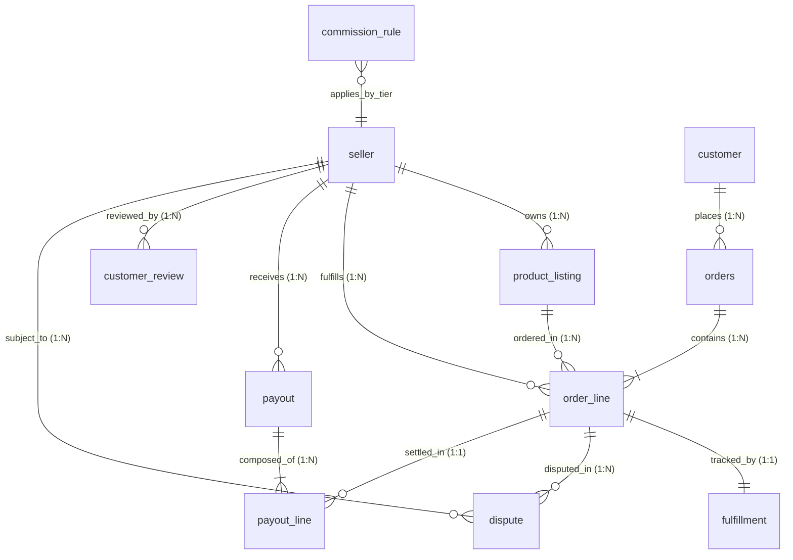

# Data Dictionary

Comprehensive data dictionary for the Seller Operations Monitor platform. For each entity, every field specifies data type, nullability, allowed values/formats, units, uniqueness, and validation rules.

---

## 1. Seller (`seller`)
Master record representing registered marketplace sellers.

| Field Name | Type | Required/Optional | Allowed Values | Units | Uniqueness | Validation Rule / Constraint |
|---|---|---|---|---|---|---|
| `seller_id` | VARCHAR(30) | Required | Pattern: `SELL-[0-9]{6}` | Dimensionless | Unique (PK) | Primary key; immutable identifier. |
| `seller_name` | VARCHAR(200) | Required | Non-empty string | Dimensionless | Non-unique | Must be non-blank. |
| `status` | VARCHAR(20) | Required | `PENDING`, `ACTIVE`, `SUSPENDED`, `REACTIVATED` | Dimensionless | Non-unique | Lifecycle state enum. Transitions logged to `seller_status_event`. |
| `join_date` | DATE | Required | ISO 8601 Date (`YYYY-MM-DD`) | Calendar Date | Non-unique | Must be <= current operational date. |
| `category` | VARCHAR(50) | Required | `Electronics`, `Fashion`, `Home`, `Beauty`, `Grocery`, `Sports` | Dimensionless | Non-unique | Primary merchandising category. |
| `commission_tier` | VARCHAR(30) | Required | `STANDARD`, `PREMIUM` | Dimensionless | Non-unique | Maps to commission fee structure. |
| `reserve_rate` | NUMERIC(8,6) | Required | `0.000000` to `1.000000` (e.g. 0.05, 0.15, 0.25) | Percentage ratio | Non-unique | Rate >= 0 and <= 1. High risk: 25%, New: 15%, Established: 5%. |

---

## 2. Product Listing (`product_listing`)
Catalog items published by sellers.

| Field Name | Type | Required/Optional | Allowed Values | Units | Uniqueness | Validation Rule / Constraint |
|---|---|---|---|---|---|---|
| `listing_id` | VARCHAR(60) | Required | Pattern: `LIST-SELL-[0-9]{6}-[0-9]{6}` | Dimensionless | Unique (PK) | Primary key; structured prefix with seller ID. |
| `seller_id` | VARCHAR(30) | Required | Valid `seller.seller_id` | Dimensionless | Non-unique | Foreign key referencing `seller(seller_id)`. |
| `product_id` | VARCHAR(40) | Required | Pattern: `PROD-[0-9]{8}` | Dimensionless | Non-unique | Product catalog identifier. |
| `sku` | VARCHAR(100) | Required | Pattern: `SKU-[0-9]{8}` | Dimensionless | Unique | Stock keeping unit identifier; globally unique. |
| `title` | VARCHAR(250) | Required | Non-empty descriptive string | Dimensionless | Non-unique | Descriptive catalog item title. |
| `category` | VARCHAR(50) | Required | Merchandising categories | Dimensionless | Non-unique | Must match listing catalog category. |
| `price` | NUMERIC(12,2) | Required | Price > 0.00 | INR (Currency) | Non-unique | Monetary price strictly positive. |
| `stock_quantity` | INTEGER | Required | Integer >= 0 | Item count | Non-unique | Available inventory stock count. |
| `listing_status` | VARCHAR(30) | Required | `DRAFT`, `ACTIVE`, `PAUSED`, `DISCONTINUED` | Dimensionless | Non-unique | Suspended seller must not have active listings without flag. |
| `created_at` | TIMESTAMP | Required | ISO 8601 Timestamp | UTC Timestamp | Non-unique | Must be >= seller `join_date`. |

---

## 3. Order (`orders`)
Customer purchase transaction header.

| Field Name | Type | Required/Optional | Allowed Values | Units | Uniqueness | Validation Rule / Constraint |
|---|---|---|---|---|---|---|
| `order_id` | VARCHAR(30) | Required | Pattern: `ORD-YYYY-[0-9]{6}` | Dimensionless | Unique (PK) | Primary key; yearly counter format. |
| `customer_id` | VARCHAR(30) | Required | Valid `customer.customer_id` | Dimensionless | Non-unique | Foreign key referencing `customer(customer_id)`. |
| `order_date` | DATE | Required | ISO 8601 Date (`YYYY-MM-DD`) | Calendar Date | Non-unique | Date when customer placed order. |
| `currency` | CHAR(3) | Required | `INR` (ISO 4217) | Currency Code | Non-unique | Default operational currency. |
| `order_status` | VARCHAR(30) | Required | `PROCESSING`, `SHIPPED`, `DELIVERED`, `CANCELLED`, `RETURNED` | Dimensionless | Non-unique | Lifecycle state transition. |
| `gross_amount` | NUMERIC(14,2) | Required | Amount >= 0.00 | INR (Currency) | Non-unique | Sum of child order lines `line_total`. |
| `discount_amount` | NUMERIC(14,2) | Required | Amount >= 0.00 | INR (Currency) | Non-unique | Order-level promotional discount. |
| `shipping_amount` | NUMERIC(14,2) | Required | Amount >= 0.00 | INR (Currency) | Non-unique | Delivery/handling charge. |
| `tax_amount` | NUMERIC(14,2) | Required | Amount >= 0.00 | INR (Currency) | Non-unique | Applied GST/sales tax. |
| `net_order_amount` | NUMERIC(14,2) | Required | Amount >= 0.00 | INR (Currency) | Non-unique | Reconciles: `gross_amount - discount_amount + shipping_amount + tax_amount`. |

---

## 4. Order Line (`order_line`)
Individual items within an order; enables multi-seller order splitting.

| Field Name | Type | Required/Optional | Allowed Values | Units | Uniqueness | Validation Rule / Constraint |
|---|---|---|---|---|---|---|
| `order_line_id` | VARCHAR(50) | Required | Pattern: `OL-ORD-YYYY-[0-9]{6}-[0-9]{2}` | Dimensionless | Unique (PK) | Primary key; embeds parent order ID and sequence. |
| `order_id` | VARCHAR(30) | Required | Valid `orders.order_id` | Dimensionless | Non-unique | Foreign key referencing `orders(order_id)`. |
| `listing_id` | VARCHAR(60) | Required | Valid `product_listing.listing_id` | Dimensionless | Non-unique | Foreign key referencing `product_listing(listing_id)`. |
| `seller_id` | VARCHAR(30) | Required | Valid `seller.seller_id` | Dimensionless | Non-unique | Foreign key referencing `seller(seller_id)`. |
| `quantity` | INTEGER | Required | Integer >= 1 | Units | Non-unique | Purchased count strictly positive. |
| `unit_price` | NUMERIC(12,2) | Required | Amount > 0.00 | INR (Currency) | Non-unique | Unit listing price at purchase. |
| `discount_amount` | NUMERIC(12,2) | Required | Amount >= 0.00 | INR (Currency) | Non-unique | Promotional item discount. |
| `line_total` | NUMERIC(14,2) | Required | Amount >= 0.00 | INR (Currency) | Non-unique | Arithmetic reconciliation: `(quantity * unit_price) - discount_amount`. |

---

## 5. Fulfillment (`fulfillment`)
Shipment and delivery tracking for an order line.

| Field Name | Type | Required/Optional | Allowed Values | Units | Uniqueness | Validation Rule / Constraint |
|---|---|---|---|---|---|---|
| `fulfillment_id` | VARCHAR(80) | Required | Pattern: `FUL-OL-ORD-YYYY-[0-9]{6}-[0-9]{2}` | Dimensionless | Unique (PK) | Primary key; derived from order line ID. |
| `order_line_id` | VARCHAR(50) | Required | Valid `order_line.order_line_id` | Dimensionless | Unique | 1:1 Foreign key referencing `order_line(order_line_id)`. |
| `seller_id` | VARCHAR(30) | Required | Valid `seller.seller_id` | Dimensionless | Non-unique | Foreign key referencing `seller(seller_id)`. |
| `fulfillment_status`| VARCHAR(30) | Required | `PROCESSING`, `SHIPPED`, `DELIVERED`, `CANCELLED` | Dimensionless | Non-unique | Logistics progression state. |
| `promised_ship_date`| DATE | Required | ISO 8601 Date | Calendar Date | Non-unique | Promised shipping SLA date (>= order date). |
| `actual_ship_date` | DATE | Optional | ISO 8601 Date or NULL | Calendar Date | Non-unique | Recorded carrier dispatch date. |
| `promised_delivery_date` | DATE | Required | ISO 8601 Date | Calendar Date | Non-unique | Promised delivery SLA date (>= promised ship date). |
| `actual_delivery_date` | DATE | Optional | ISO 8601 Date or NULL | Calendar Date | Non-unique | Recorded customer receipt date (>= actual ship date). |
| `carrier` | VARCHAR(50) | Optional | `Delhivery`, `BlueDart`, `EcomExpress`, `DTDC`, `XpressBees` | Dimensionless | Non-unique | Assigned 3PL logistics provider. |
| `tracking_number` | VARCHAR(100) | Optional | Carrier tracking string | Dimensionless | Non-unique | Airway bill / tracking number. |
| `return_status` | VARCHAR(30) | Required | `NONE`, `RETURN_REQUESTED`, `RETURNED` | Dimensionless | Non-unique | Post-delivery reverse logistics flag. |
| `sla_status` | VARCHAR(30) | Optional | `ON_TIME`, `LATE`, `SEVERELY_LATE` | Dimensionless | Non-unique | SLA calculation: `ON_TIME` if actual <= promised ship date. |

---

## 6. Customer Review (`customer_review`)
Post-fulfillment feedback and rating from customer.

| Field Name | Type | Required/Optional | Allowed Values | Units | Uniqueness | Validation Rule / Constraint |
|---|---|---|---|---|---|---|
| `review_id` | VARCHAR(40) | Required | Pattern: `REV-[0-9]{8}` | Dimensionless | Unique (PK) | Primary key. |
| `order_id` | VARCHAR(30) | Required | Valid `orders.order_id` | Dimensionless | Non-unique | Foreign key referencing `orders(order_id)`. |
| `seller_id` | VARCHAR(30) | Required | Valid `seller.seller_id` | Dimensionless | Non-unique | Foreign key referencing `seller(seller_id)`. |
| `rating` | INTEGER | Required | Integers `1`, `2`, `3`, `4`, `5` | Stars / Score | Non-unique | Must satisfy `1 <= rating <= 5`. |
| `review_date` | DATE | Required | ISO 8601 Date | Calendar Date | Non-unique | Review date >= order date. |

---

## 7. Dispute (`dispute`)
Customer chargebacks, non-delivery claims, or damage disputes.

| Field Name | Type | Required/Optional | Allowed Values | Units | Uniqueness | Validation Rule / Constraint |
|---|---|---|---|---|---|---|
| `dispute_id` | VARCHAR(30) | Required | Pattern: `DSP-YYYY-[0-9]{6}` | Dimensionless | Unique (PK) | Primary key; yearly counter format. |
| `order_id` | VARCHAR(30) | Required | Valid `orders.order_id` | Dimensionless | Non-unique | Foreign key referencing `orders(order_id)`. |
| `order_line_id` | VARCHAR(50) | Required | Valid `order_line.order_line_id` | Dimensionless | Non-unique | Foreign key referencing `order_line(order_line_id)`. |
| `seller_id` | VARCHAR(30) | Required | Valid `seller.seller_id` | Dimensionless | Non-unique | Foreign key referencing `seller(seller_id)`. |
| `dispute_type` | VARCHAR(40) | Required | `CHARGEBACK`, `ITEM_NOT_RECEIVED`, `DAMAGED`, `WRONG_ITEM` | Dimensionless | Non-unique | Dispute category classification. |
| `status` | VARCHAR(30) | Required | `OPEN`, `UNDER_REVIEW`, `RESOLVED`, `REJECTED` | Dimensionless | Non-unique | Dispute resolution status. |
| `dispute_amount` | NUMERIC(14,2) | Required | Amount > 0.00 | INR (Currency) | Non-unique | Disputed claim value (must be <= `line_total`). |
| `opened_date` | DATE | Required | ISO 8601 Date | Calendar Date | Non-unique | Must be >= order date. |
| `resolved_date` | DATE | Optional | ISO 8601 Date or NULL | Calendar Date | Non-unique | If resolved, must be >= `opened_date`. |
| `financially_applicable` | BOOLEAN | Required | `TRUE`, `FALSE` | Boolean | Non-unique | Flag indicates if dispute deducts from seller payout. |

---

## 8. Commission Rule (`commission_rule`)
Category and tier fee schedule.

| Field Name | Type | Required/Optional | Allowed Values | Units | Uniqueness | Validation Rule / Constraint |
|---|---|---|---|---|---|---|
| `commission_rule_id`| VARCHAR(40) | Required | Pattern: `CR-[0-9]{4}` | Dimensionless | Unique (PK) | Primary key. |
| `category` | VARCHAR(50) | Required | Merchandising categories | Dimensionless | Non-unique | Applicable product category. |
| `commission_tier` | VARCHAR(30) | Required | `STANDARD`, `PREMIUM` | Dimensionless | Non-unique | Seller qualification tier. |
| `commission_rate` | NUMERIC(8,6) | Required | `0.000000` to `1.000000` (e.g. 0.08, 0.12) | Percentage ratio | Non-unique | Rate >= 0 and <= 1. |
| `effective_from` | DATE | Required | ISO 8601 Date | Calendar Date | Non-unique | Rule activation date. |
| `effective_to` | DATE | Optional | ISO 8601 Date or NULL | Calendar Date | Non-unique | Rule expiration date (NULL = active). |

---

## 9. Payout (`payout`)
Settlement batch header for seller disbursement.

| Field Name | Type | Required/Optional | Allowed Values | Units | Uniqueness | Validation Rule / Constraint |
|---|---|---|---|---|---|---|
| `payout_id` | VARCHAR(40) | Required | Pattern: `PAYOUT-YYYY-[0-9]{6}` | Dimensionless | Unique (PK) | Primary key; settlement batch ID. |
| `seller_id` | VARCHAR(30) | Required | Valid `seller.seller_id` | Dimensionless | Non-unique | Foreign key referencing `seller(seller_id)`. |
| `payout_date` | DATE | Required | ISO 8601 Date | Calendar Date | Non-unique | Settlement date (>= delivery date + hold days). |
| `total_amount` | NUMERIC(14,2) | Required | Monetary amount | INR (Currency) | Non-unique | Must equal `SUM(payout_line.net_payout_amount)`. |
| `eligibility_status`| VARCHAR(30) | Required | `ELIGIBLE`, `ON_HOLD`, `PROCESSED`, `BLOCKED` | Dimensionless | Non-unique | Settlement readiness status. |
| `exception_code` | VARCHAR(80) | Optional | Code or NULL | Dimensionless | Non-unique | Exception reason if blocked. |

---

## 10. Payout Line (`payout_line`)
Line-level settlement calculation and reconciliation item.

| Field Name | Type | Required/Optional | Allowed Values | Units | Uniqueness | Validation Rule / Constraint |
|---|---|---|---|---|---|---|
| `payout_line_id` | VARCHAR(60) | Required | Pattern: `PL-PAYOUT-YYYY-[0-9]{6}-[0-9]{4}` | Dimensionless | Unique (PK) | Primary key; composite with payout ID. |
| `payout_id` | VARCHAR(40) | Required | Valid `payout.payout_id` | Dimensionless | Non-unique | Foreign key referencing `payout(payout_id)`. |
| `order_line_id` | VARCHAR(50) | Required | Valid `order_line.order_line_id` | Dimensionless | Non-unique | Foreign key referencing `order_line(order_line_id)`. |
| `gross_amount` | NUMERIC(14,2) | Required | Amount >= 0.00 | INR (Currency) | Non-unique | Order line gross total. |
| `commission_amount`| NUMERIC(14,2) | Required | Amount >= 0.00 | INR (Currency) | Non-unique | Deducted commission (`gross * commission_rate`). |
| `refund_amount` | NUMERIC(14,2) | Required | Amount >= 0.00 | INR (Currency) | Non-unique | Customer return refunds deducted. |
| `dispute_deduction`| NUMERIC(14,2) | Required | Amount >= 0.00 | INR (Currency) | Non-unique | Chargeback/dispute amounts deducted. |
| `reserve_amount` | NUMERIC(14,2) | Required | Amount >= 0.00 | INR (Currency) | Non-unique | Risk reserve hold (`(gross - fees) * reserve_rate`). |
| `net_payout_amount`| NUMERIC(14,2) | Required | Monetary amount | INR (Currency) | Non-unique | Reconciles: `gross - commission - refund - dispute - reserve`. |

---

## Entity Relationships & Cardinality

## ID Conventions Summary
- **Seller**: `SELL-000001`
- **Product Listing**: `LIST-SELL-000001-000001`
- **Order**: `ORD-2026-000001`
- **Order Line**: `OL-ORD-2026-000001-01`
- **Fulfillment**: `FUL-OL-ORD-2026-000001-01`
- **Dispute**: `DSP-2026-000001`
- **Payout**: `PAYOUT-2026-000001`
- **Payout Line**: `PL-PAYOUT-2026-000001-0001`
- **Commission Rule**: `CR-0001`
- **Customer Review**: `REV-00000001`
- **Seller Status Event**: `SE-000001`
- **Ground Truth Case**: `GT-000001`
